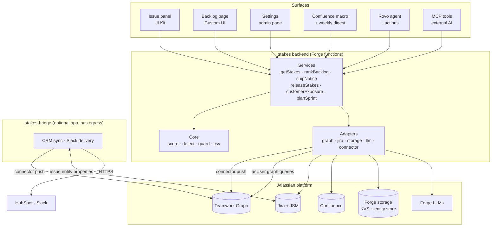
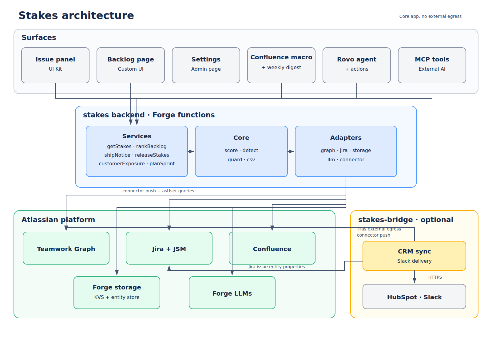

# Stakes

**Know what's riding on every work item.**

Stakes is a Forge app for Jira that connects work to the customers waiting on it, the deal value it blocks, the support requests behind it, and the goal it serves. It turns that evidence into an explainable 0–100 score, ranks the backlog, and flags silent fires and phantom priorities. When the work ships, Stakes drafts the updates for account owners and support agents; a person reviews and sends them. The score is deterministic arithmetic, not an AI guess, and every number links back to its evidence.

> **Production assets and live validation are pending.** The production installation URLs, `PAY-142` hero screenshot, and approval-screen captures have not been added. The guide has not yet been validated by a logged-out installation check, a timed fresh install, or an independent friend installing without help.

**Hero screenshot — pending:** a production capture of the `PAY-142` Stakes panel will be added under [`docs/install-guide/`](docs/install-guide/). No mock or substitute screenshot is included.

## What you can try

1. **See the stakes:** open an issue panel with its score, six signal tiles, suggested priority, and a source-linked evidence drawer.
2. **Decide:** open the ranked `PAY` backlog, find silent fires and phantom priorities, and apply suggested priorities only after confirmation. Sprint planning also proposes a scope within the team's capacity.
3. **Close the loop:** move `PAY-142` to Done or release `2026.12`, review the ship notice, and send the Jira and JSM updates.
4. **Ask anywhere:** use the Stakes Analyst Rovo agent or the same read-only tools through MCP.

Jira is required. Confluence, Rovo, MCP, HubSpot, and Slack are optional; the core demo needs no external account.

## Install and explore

### 1. Prepare a site

Use an empty Atlassian site where you are an **organization admin** and can create Jira projects. Teamwork Graph scopes require organization-admin approval. A Forge demo site created with `forge site provision` includes Rovo and is the recommended evaluation environment.

Use a fresh browser profile if you want to reproduce the intended fresh-install check. No timed or independent install result is claimed yet.

### 2. Install the core app

**Production `stakes` installation URL: pending.** It will be added after the production deployment and logged-out link check; there is deliberately no placeholder hyperlink to follow.

1. Open the production installation URL and sign in.
2. Choose your evaluation site.
3. Review the requested Jira, Teamwork Graph, storage, and optional Confluence scopes, then approve the installation. You must be an organization admin.
4. Wait for the installation to finish before opening Stakes settings.

**Production approval-screen captures: pending.** The final guide must include the actual core Jira consent screen, the optional Confluence consent screen if separately presented, and the optional bridge consent screen. Captures must come from the production installation and hide real names and site URLs.

### 3. Create the two demo projects

Create these projects on the empty site:

| Project | Key | Template |
|---|---|---|
| Orbit Pay software project | `PAY` | Jira Scrum |
| Orbit Pay service desk | `HELP` | Jira Service Management, IT service management |

Use empty projects so the seeded issue keys remain `PAY-142`, `PAY-150`, and the other keys used below. If a selected project already contains issues, Stakes maps demo stories to new keys and shows that mapping after seeding.

### 4. Load the fictional Orbit Pay data

1. Open **Apps → Stakes settings → Data**.
2. Under **Software project**, select `PAY`.
3. Under **Service project**, select `HELP`.
4. Click **Load demo data** and leave the page open while the progress indicator runs. Allow about a minute. If loading stops with an error, press the button again to resume from the recorded step.
5. Wait for the loaded state before opening the demo issues.

The seeder creates 25 `PAY` issues, 15 linked `HELP` requests, 8 fictional customers, 12 fictional deals, release `2026.12`, two sprints, and demo score history. Everything it creates is tracked for removal; demo Jira issues and requests carry the `stakes-demo` label. Account owners map to your own Atlassian account so mentions and notices have a real recipient without storing owner email addresses.

**Optional one-minute goal step:** create or open the Atlassian goal **Reduce enterprise churn** and link it to `PAY-142`. An app cannot create an Atlassian goal, so this step is manual. Without it, `PAY-142` scores **83**; with the on-track goal linked, it scores **89**. Both results are Highest-priority silent fires.

### 5. Open the first insight

1. Open **PAY → Stakes**. The **Backlog** tab ranks open issues by Stakes Score. `PAY-142` is a Low-priority **Silent fire**; `PAY-150` is a Highest-priority **Phantom priority** with no evidence.
2. Open `PAY-142` (**CSV export times out above 10k rows**). In the Stakes issue panel, inspect the score, suggested priority, six signal tiles, and summary.
3. Expand the evidence drawer. Open the deal, customer, request, conversation, and goal sources where available. The three open deals total **US$480K** before stage probability is applied.
4. Optional: select issues in the backlog and choose **Apply suggested priorities**. Review the confirmation carefully; applying changes Jira priorities and posts an audit comment. Nothing changes before confirmation.
5. Optional: open **Releases**, **Customers**, or **Sprint plan** on the same project page. Sprint moves also require confirmation.
6. Optional: in Jira issue search, try the read-only score field with its expected generated alias:

   ```jql
   "Stakes Score[Number]" >= 55 ORDER BY "Stakes Score[Number]" DESC
   ```

   Confirm the generated field alias on the site if Jira does not recognize this query. The field does not need to be added to a project screen to be searchable.

## Optional product steps

### Confluence digest and macro

Skip this section if you only installed Stakes for Jira.

1. Ask an organization admin to add Confluence to the existing Stakes installation in Atlassian administration, then reload Stakes settings. If the installation presents another consent screen, review and approve it.
2. Open **Apps → Stakes settings → Confluence**.
3. Turn on **Weekly Confluence digest**, choose a **Parent page**, and click **Save Confluence settings**.
4. Click **Run digest now** to generate the page without waiting for the Monday schedule.
5. To try the macro, edit a Confluence page, insert **Stakes**, and choose a project, fix version, or customer view.

Jira scoring continues to work when Confluence is not connected.

### Rovo agent

1. Open Rovo chat on the evaluation site and select **Stakes Analyst**.
2. Ask any of the four demo questions:
   - What should we fix first in PAY?
   - What is Kilima Freight waiting on?
   - What revenue does release 2026.12 unblock?
   - Draft an update for customers waiting on PAY-142.
3. Follow the returned source links. The agent's actions are read-only; priority changes, sprint moves, and sending notices happen in the confirmed app UI.

### MCP client

External MCP access is off until a site admin enables it for the Stakes installation. Rovo and MCP are not required for the Jira demo.

1. In Atlassian administration, enable external MCP access for Stakes.
2. Find the production app ID in the app's administration details. **The production app ID is pending**, so replace `<appId>` below only with the real ID; do not use the all-zero development placeholder from the manifest.
3. Add the server to Claude Code:

   ```bash
   claude mcp add --transport http stakes https://mcp.atlassian.com/forge/<appId>
   ```

4. Start Claude Code and complete sign-in with `/mcp`.
5. Ask a Stakes question or invoke a tool such as `stakes_get_issue_stakes` with `issueKey: "PAY-142"`.

The MCP endpoint above is the documented Atlassian connection pattern, not a claim that a production MCP connection has been tested. See [`skill.md`](skill.md) for all seven tools and their usage rules.

### Ship notice

This step writes to the demo Jira and JSM issues when you click **Send**.

1. Move `PAY-142` to a Done status category. Alternatively, or afterwards, release the `2026.12` fix version from the `PAY` release page.
2. Reopen `PAY-142` and open the **Ship notice** tab in the Stakes panel.
3. Review the recipients, internal note, and customer-facing drafts. Edit them if needed.
4. Click **Send** only when you are ready to post the internal Jira comment and the linked JSM request replies or notes.

Without the optional bridge, the flow stays inside Jira and JSM. With the bridge configured, its scheduled delivery also sends the internal note to Slack.

### Optional `stakes-bridge`: HubSpot and Slack

The bridge is a separate app for live HubSpot sync and Slack delivery. It has external egress by design and is **not** Runs on Atlassian eligible. It is not needed for the fictional core demo. Use only your own HubSpot developer account and Slack workspace.

**Production `stakes-bridge` installation URL: pending.** It will be added only after the production deployment and logged-out link check.

1. Open the production bridge installation URL, select the same site, review its scopes and external access, and approve it.
2. Open **Apps → Stakes bridge settings**.
3. For HubSpot, enter a private-app token and click **Test and save HubSpot token**. Use deals with a `jira_issue_keys` property containing the Jira keys they depend on. Click **Sync now** to run a sync immediately; otherwise the scheduled sync runs hourly. Editing a synced deal and running **Sync now** updates the evidence used on the next score refresh.
4. For Slack, enter a bot token and default channel, then click **Test and save Slack configuration**.
5. Send a ship notice as described above. The bridge looks for sent, undelivered notices on its five-minute schedule, posts the internal note to the configured channel, and sends direct messages to owners it can match by email.

These are setup instructions, not a claim that live HubSpot or Slack delivery has been tested from a production installation.

## Clean-up

### Remove the demo

1. Open **Apps → Stakes settings → Data**.
2. Click **Remove demo data** and confirm **Remove demo data** in the dialog.
3. Wait for removal to finish. This deletes the demo issues and support requests labelled `stakes-demo`, the 8 demo customers and 12 deals in Stakes storage and the Teamwork Graph, release `2026.12`, the two demo sprints, demo score history, and seeded percentiles.
4. Delete the manually linked **Reduce enterprise churn** goal if you created it only for this evaluation. The seeder does not create or remove goals.

Your own imported data is intentionally preserved. **Remove demo data is not a general erase-all-imports control.**

### Remove the rest of an evaluation

- Disconnect the **Stakes CRM** connector in Atlassian administration to delete the objects ingested through that connection. If you installed the bridge, disconnect **Stakes bridge CRM** as well.
- Uninstall `stakes-bridge` first, if present, and then uninstall `stakes`.
- Delete any optional Confluence digest pages you created, and remove any test records or messages you created in HubSpot or Slack.
- Non-demo CSV mirror rows and other content you created yourself are not removed by the demo button. Use the site's data-administration and deletion processes for anything outside the recorded demo dataset; do not assume uninstalling is the same operation as **Remove demo data**.

## Architecture

The core `stakes` app has no external egress. Every UI and conversational surface uses the same Forge backend, deterministic core, and Atlassian adapters. The separate optional bridge owns the only external calls.





The detailed request flows, permission contexts, and two-app handoff are in [`docs/architecture.md`](docs/architecture.md).

## Stakes Score

AI never calculates the score. Six raw evidence signals are normalized to `0..1`, multiplied by configurable weights, and scaled to `0..100`.

### Signals and default weights

| Signal | Symbol | Raw value | Default weight |
|---|---|---|---|
| Revenue at risk | `R` | Sum of open deal `amountUsd × probability`, plus ARR for linked customers renewing within 90 days | 0.35 |
| Support pressure | `S` | Sum over open linked JSM requests of `priorityWeight + 0.5 × floor(ageDays / 14)`; an escalated request's whole term counts twice | 0.20 |
| Customer reach | `C` | Sum over distinct linked customers of tier weight: Enterprise 3, Mid-market 2, SMB 1 | 0.15 |
| Conversation heat | `H` | Conversations or messages mentioning the issue in the last 30 days | 0.10 |
| Goal alignment | `G` | 0 with no goal, 1 with a linked goal, 1.5 when the goal is At risk or Off track | 0.10 |
| Urgency | `U` | Days until the nearest deal close, renewal, or SLA breach; no date is `null` | 0.10 |

JSM priority weights are Highest 4, High 3, Medium 2, and Low/Lowest 1, with documented aliases handled by the scorer. Closed deals are excluded, customers are deduplicated, and past urgency dates count as zero days.

### Normalization and formula

For `R`, `S`, `C`, and `H`:

```text
n(x) = min(1, ln(1 + x) / ln(1 + p95))
p95 used = max(project p95, floor)
floors: R = 100,000; S = 5; C = 3; H = 5
```

The project p95 comes from scored open issues. The seeded demo keeps its documented p95 values until at least 10 non-demo issues have been scored.

For goal alignment and urgency:

```text
n(G) = G / 1.5
n(U) = 0 when U is null; otherwise max(0, 1 - U / 90)
```

For `k ∈ {R, S, C, H, G, U}`:

```text
Score = round(100 × Σ(wₖ × nₖ) / Σwₖ)
contributionₖ = 100 × wₖ × nₖ / Σwₖ
```

Weights are renormalized when saved. The score is computed from unrounded contributions and rounded once; tile values are rounded only for display.

Suggested priority bands are Highest for 75–100, High for 55–74, Medium for 35–54, Low for 15–34, and Lowest for 0–14. A **Silent fire** has score at least 55 and current priority Low or Lowest. A **Phantom priority** has current priority High or Highest, score below 15, and no evidence.

### Worked example: `PAY-142`

The three deals contribute probability-weighted revenue of:

```text
R = (US$220,000 × 0.60) + (US$160,000 × 0.90) + (US$100,000 × 0.40)
  = US$316,000 weighted (US$480,000 open)
```

There are no renewals inside 90 days. The other raw inputs are `S = 15.5` from seven age- and priority-weighted `HELP` requests, `C = 8` from two Enterprise and one Mid-market customer, `H = 6` messages, `G = 1` for the manually linked on-track goal, and `U = 25` days to the nearest close date.

The demo uses project p95 values `R = 450,000`, `S = 18`, `C = 9`, and `H = 10`:

| Signal | Normalized value | Weight | Points |
|---|---:|---:|---:|
| `R` | `ln(316001) / ln(450001) = 0.973` | 0.35 | 34.0 |
| `S` | `ln(16.5) / ln(19) = 0.952` | 0.20 | 19.0 |
| `C` | `ln(9) / ln(10) = 0.954` | 0.15 | 14.3 |
| `H` | `ln(7) / ln(11) = 0.811` | 0.10 | 8.1 |
| `G` | `1 / 1.5 = 0.667` | 0.10 | 6.7 |
| `U` | `1 - 25 / 90 = 0.722` | 0.10 | 7.2 |
| **Score** | | | **89** |

Because `PAY-142` is currently Low, 89 makes it a Highest-suggested **Silent fire**. Without the manually linked goal, the score is 83 and the badge remains. See [`docs/scoring.md` §8](docs/scoring.md#8-worked-example-pay-142) for the calibration and demo-percentile details.

## Data handling and egress

| Data | Where it lives |
|---|---|
| Customer and deal mirror, issue links, demo messages | `stakes` Forge custom entity store |
| Latest evidence snapshots and score history | `stakes` Forge entity store |
| Priority/sprint audit records and ship notices | `stakes` Forge entity store |
| Settings, connector connection ID, seed records, percentiles, digest state, and LLM usage counters | `stakes` Forge KVS |
| Generated text cache | `stakes` Forge entity store |
| Customer organizations, deals, and their Jira associations | Atlassian Teamwork Graph through the connectors |
| JQL-searchable score | Read-only Jira custom field value |
| Cross-app CRM and ship-notice handoff | Jira issue entity properties |
| HubSpot and Slack tokens | `stakes-bridge` Forge secret storage, never the manifest or ordinary KVS settings |

`stakes` declares **no `external.fetch`, remotes, or providers**. It makes no external network calls and uses Atlassian-hosted Forge LLMs for generated summaries and drafts. Graph and user-facing REST reads run with the viewer's permissions; Rovo actions and MCP tools are read-only. Owner emails from CSV imports are resolved to Atlassian account IDs and discarded. Logs are restricted to IDs, counts, operation names, and durations rather than customer names, deal values, ticket text, or prompts.

The optional `stakes-bridge` is different: it makes read requests to **HubSpot**, and sends the **internal ship note and owner email addresses for Slack user lookup** to **Slack**. It also exchanges CRM and delivery data with Atlassian through Teamwork Graph connectors and Jira issue properties. The bridge never writes back to the CRM during its normal sync. Its settings UI returns only masked token status, not the saved secrets.

Use [Clean-up](#clean-up) to remove the demo and disconnect or uninstall the evaluation apps. The demo button removes the recorded demo dataset while preserving non-demo imports.

## Teamwork Graph persisted-query caveat

The current query plan uses persisted queries for `stakes_q1_deals`, `stakes_q3_conversations`, and `stakes_q5_team`; goals use the curated `jiraWorkItemGoals` query, and escalations come from linked JSM requests over Jira REST. The exact persisted-query save flow and whether saved queries are per-site or per-app remain unconfirmed in [`docs/teamwork-graph.md`](docs/teamwork-graph.md#registering-a-persisted-query).

**Judges do not need to register persisted queries for the core demo.** If Q1 is unavailable, the Forge entity-store mirror supplies demo/CSV deals and customers, while the bridge issue property supplies live deals. Demo conversations also come from the mirror when Q3 is unavailable. If Q5 is unavailable, Stakes omits the team line. Evidence labels identify whether an item came from the graph, Jira REST, mirror, or bridge, so these fallbacks are visible rather than hidden.

Any future per-site registration instructions must be verified in the real explorer before being added to this guide.

## Documentation and licence

- [Technical documentation index](docs/README.md)
- [Architecture](docs/architecture.md), [data model](docs/data-model.md), and [security and privacy](docs/security.md)
- [Scoring specification](docs/scoring.md) and [Teamwork Graph integration](docs/teamwork-graph.md)
- [Development setup](docs/development.md) for contributors
- [`skill.md`](skill.md) for MCP clients
- [MIT licence](LICENSE)
