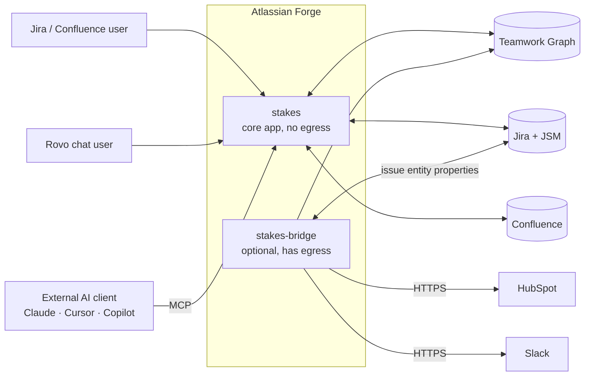
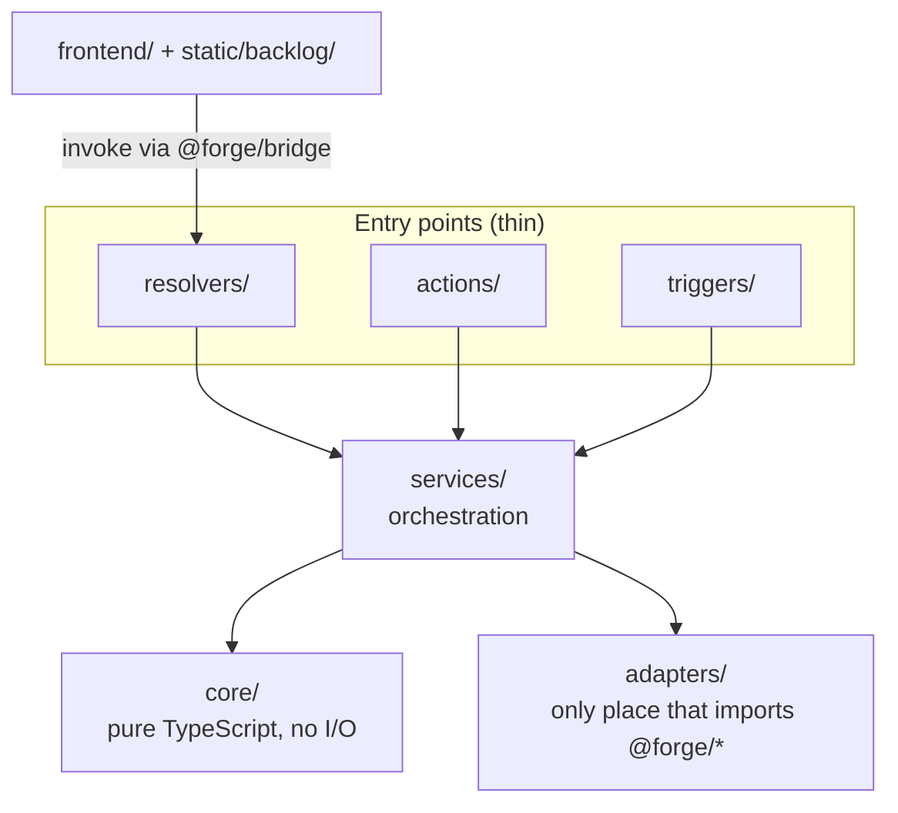
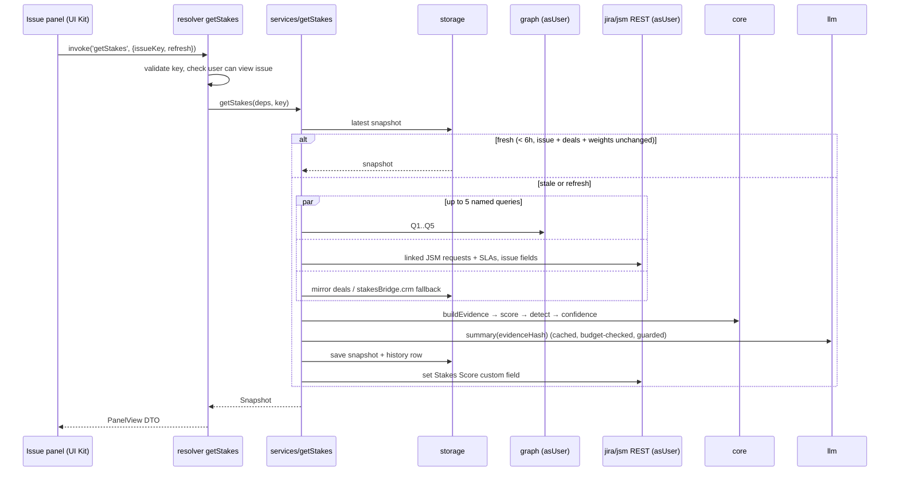
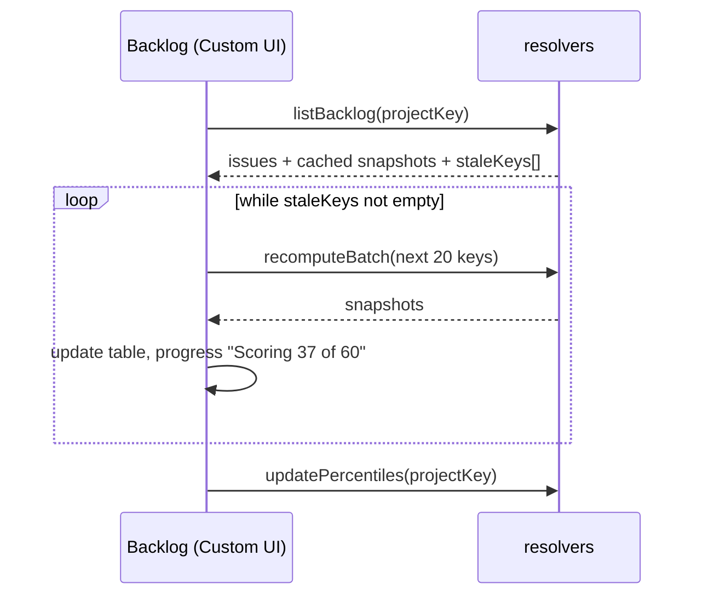
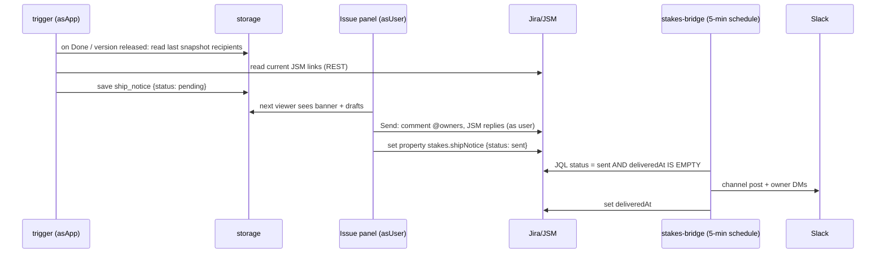

# Architecture

## 1. System context

Stakes runs entirely on Atlassian Forge. There is no server we host, no database we operate, and the core app makes no outbound network calls.



## 2. Layers inside `stakes`

Strict one-way dependencies, enforced by `eslint-plugin-boundaries`:



| Layer | May import | Must not import | Responsibility |
|---|---|---|---|
| `core/` | other `core/` files, `packages/contracts` | `@forge/*`, `adapters/`, `services/` | Score, normalisation, bands, detection, confidence, sprint knapsack, CSV parsing, numeric guard |
| `adapters/` | `@forge/*`, `core/` types | `services/`, entry points | One narrow interface per external system: `graph`, `jira`, `jsm`, `confluence`, `storage`, `llm`, `connector`, `field` |
| `services/` | `core/`, adapter **interfaces** | concrete adapters directly | Use cases: `getStakes`, `rankBacklog`, `releaseStakes`, `customerExposure`, `planSprint`, `shipNotice`, `weeklyDigest` |
| `resolvers/`, `actions/`, `triggers/` | `services/`, adapter factories | `core/` logic (call a service instead) | Validate input, build adapters for the right auth context, call one service, shape the response |
| `frontend/`, `static/backlog/` | `@forge/bridge`, `@forge/react`, `packages/contracts` types | anything in `src/` | Render; call resolvers only |

Services receive adapters as parameters (constructor or function argument), so tests pass fakes and never need a site.

```ts
// services/getStakes.ts (shape, not final code)
export interface GetStakesDeps {
  graph: GraphReader;
  jira: JiraReader;
  storage: SnapshotStore;
  llm: SummaryWriter;
  clock: () => Date;
}

export async function getStakes(deps: GetStakesDeps, issueKey: IssueKey, opts: { refresh: boolean }): Promise<Snapshot>;
```

### Auth context

Forge offers two identities: `asUser()` (the viewing user) and `asApp()` (the app). The entry point decides which one the adapters use.

| Path | Identity | Teamwork Graph allowed? |
|---|---|---|
| Resolvers (panel, backlog, settings, macro) | `asUser()` | Yes |
| Rovo actions, MCP tools | `asUser()` (the caller) | Yes |
| Product event triggers | `asApp()` | **No.** No user means no graph reads |
| Scheduled triggers (digest, nightly) | `asApp()` | **No** |

Adapter factories make this explicit: `makeAdapters({ as: 'user' })` and `makeAdapters({ as: 'app' })`. The app-context factory returns a graph adapter that throws, so a mistake fails loudly in tests.

## 3. Request flows

### 3.1 Issue panel load (`getStakes`)



Fresh-snapshot test, in order: `computedAt` within six hours, `issue.updated <= computedAt`, mirror `dealsVersion` unchanged, `settings.weightsVersion` unchanged.

### 3.2 Backlog ranking

The backlog page lists open issues through a resolver, reads cached snapshots in one call, then recomputes stale ones **from the browser** in batches of 20 (`recomputeBatch`). This keeps every graph read `asUser` and each invocation inside the Forge time limit. Sorting, filtering and the "cut" toggle on the Releases tab are pure client-side computations over the returned DTOs.



### 3.3 Ship notice



Triggers never post comments: anything visible to people happens as the human who clicked Send.

### 3.4 CRM ingestion

| Source | Path | Lands in |
|---|---|---|
| CSV upload | settings page → `importCsv` resolver → `core/csv` validate → connector adapter | Teamwork Graph + entity-store mirror |
| Demo seeder | settings page → `seedDemo` → Jira REST (issues, requests, links, version, sprints) + connector | Same + Jira projects |
| Live HubSpot | `stakes-bridge` hourly trigger → bridge connector | Teamwork Graph + `stakesBridge.crm` issue property |

The evidence collector reads deals in this order, stopping at the first source that answers:

1. Teamwork Graph Q1 (if the Nov 13 gate confirms connector deals are queryable).
2. `stakesBridge.crm` issue property (live data, if the bridge is installed).
3. Entity-store mirror (CSV and demo data).

Every evidence item records which `source` it came from, and the panel shows it.

## 4. The two-app split

`stakes` must stay eligible for **Runs on Atlassian**, which allows no external domains other than analytics. Live CRM sync and Slack delivery need egress, so they live in `stakes-bridge`. See [ADR-0002](adr/0002-two-app-split.md).

The apps never share storage. Their only contract is:

| Channel | Direction | Shape defined in |
|---|---|---|
| Teamwork Graph connector objects | bridge → graph → stakes | [teamwork-graph.md](teamwork-graph.md) |
| `stakesBridge.crm` issue property | bridge → stakes | `packages/contracts` |
| `stakes.shipNotice` issue property (JQL-indexed) | stakes → bridge (and `deliveredAt` back) | `packages/contracts` |

Both apps import the same `packages/contracts` types and zod schemas, and a round-trip test in each app guards the contract.

## 5. Failure handling

| Failure | Behaviour |
|---|---|
| Graph returns HTTP 200 with `errors` or an unexpectedly empty list | Logged as `degraded`, evidence item list marked partial; panel shows "Teamwork Graph signals unavailable"; score still computed from other sources |
| Graph call throws or times out | Same as above |
| Jira REST 403 on a linked item | Item skipped; panel shows "You don't have access to some linked items" |
| LLM off, over budget, error, or guard rejects output | Template summary; no error shown |
| Confluence not in the installation | Digest records `skipped: confluence-not-connected`; macro and settings explain how to add it |
| Snapshot write fails | Panel still renders the computed result; next load recomputes |

Rule: a degraded data source lowers **confidence**, it never shows an error page.

## 6. Performance budget

| Operation | Budget | How |
|---|---|---|
| Panel, cached | < 2 s | One storage read, no graph or LLM call |
| Panel, cold | < 8 s | Graph queries in parallel, LLM summary cached by evidence hash |
| Backlog batch | 20 issues per invocation | Client-driven loop |
| Graph queries per panel load | ≤ 5 | Q1–Q5 only |
