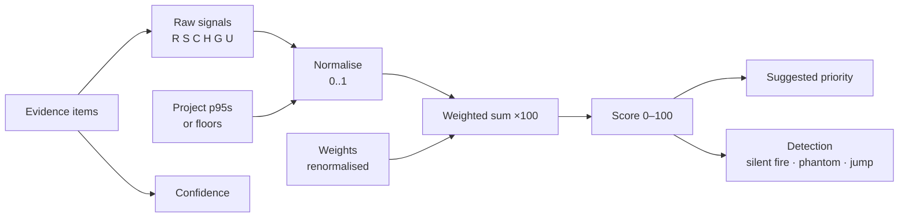

# The Stakes Score

The Stakes Score is a deterministic 0–100 number computed by pure functions in `src/core/`. AI never computes or changes it. The same inputs always produce the same score, which is what makes it testable and explainable.

## 1. Pipeline



| Module | Function | Signature |
|---|---|---|
| `core/signals.ts` | `rawSignals` | `(evidence: EvidenceItem[], now: Date) => RawSignals` |
| `core/normalise.ts` | `normalise` | `(raw: RawSignals, p95: P95, scoredCount: number) => NormSignals` |
| `core/score.ts` | `score` | `(norm: NormSignals, weights: Weights) => { score: number; contributions: Contributions }` |
| `core/bands.ts` | `suggestPriority` | `(score: number, bands: Bands) => BandName` |
| `core/detect.ts` | `detect` | `(input: DetectInput) => Badge[]` |
| `core/confidence.ts` | `confidence` | `(evidence: EvidenceItem[], now: Date) => 'high' \| 'medium' \| 'low'` |

## 2. Signals

| Signal | Symbol | Raw value | Default weight |
|---|---|---|---|
| Revenue at risk | R | Σ open deal `amountUsd × probability` + Σ `arrUsd` of linked customers renewing within 90 days | 0.35 |
| Support pressure | S | Σ over open linked JSM requests of `priorityWeight + 0.5 × floor(ageDays / 14)`; escalations count ×2 | 0.20 |
| Customer reach | C | Σ over distinct linked customers of tier weight (Enterprise 3, Mid-market 2, SMB 1) | 0.15 |
| Conversation heat | H | Count of conversations/messages mentioning the issue in the last 30 days | 0.10 |
| Goal alignment | G | 0 if no goal; 1 if linked to a goal; 1.5 if that goal is At risk or Off track | 0.10 |
| Urgency | U | Days until the nearest deal close, renewal or SLA breach (null if none) | 0.10 |

Details that matter for tests:

- **Deals:** closed-won and closed-lost deals are excluded. A deal linked to several issues counts its full amount on each issue (it is blocked by each of them).
- **Customers:** deduplicated by `customerId`, whether they arrived through a deal or directly.
- **JSM priority weight:** Highest 4, High 3, Medium 2, Low/Lowest 1.
- **Urgency:** dates in the past count as 0 days (maximum urgency). No dates → `U = null`.
- **Goals:** if several goals are linked, use the maximum G.

## 3. Normalisation

| Signal | Formula |
|---|---|
| R, S, C, H | `n(x) = min(1, ln(1 + x) / ln(1 + p95))` |
| G | `n(G) = G / 1.5` |
| U | `n(U) = U === null ? 0 : max(0, 1 − U / 90)` |

`p95` is the project's 95th percentile of that raw signal over scored open issues, stored at `percentiles:<projectKey>`. When the project has fewer than 10 scored issues, or the stored p95 is below the floor, the floor is used:

| Signal | Floor |
|---|---|
| R | 100,000 |
| S | 5 |
| C | 3 |
| H | 5 |

Using `max(p95, floor)` (rather than only for small projects) prevents a project of tiny deals from inflating every score.

## 4. Formula

```
Score = round( 100 × Σ wₖ·nₖ / Σ wₖ ),   k ∈ {R, S, C, H, G, U}
contributionₖ (points) = 100 × wₖ·nₖ / Σ wₖ
```

Weights are renormalised to sum to 1 when saved. The tiles show each contribution as "+N pts". Contributions are rounded for display only; the score is computed from unrounded values and rounded once.

## 5. Suggested priority bands

| Score | Band |
|---|---|
| 75–100 | Highest |
| 55–74 | High |
| 35–54 | Medium |
| 15–34 | Low |
| 0–14 | Lowest |

Bands map to the site's priority scheme by name. If a name is missing, settings asks the admin to map it, and `suggestPriority` returns `null` until they do (the Apply button is hidden).

## 6. Detection

| Badge | Rule |
|---|---|
| Silent fire | `score ≥ 55` and current priority ∈ {Low, Lowest} |
| Phantom priority | current priority ∈ {High, Highest} and `score < 15` and `evidence.length === 0` |
| Stakes jump | `score − score7DaysAgo ≥ 20` (from history; no history → no badge) |

Thresholds come from settings so they move with custom bands.

## 7. Confidence

Count distinct evidence **types** (`deal`, `customer`, `jsm_request`, `escalation`, `conversation`, `goal`) and the oldest `fetchedAt`.

| Level | Rule |
|---|---|
| High | ≥ 3 distinct types and all fetched within 7 days |
| Medium | 2 types, or ≥ 3 types with any item older than 7 days |
| Low | 0 or 1 type |

## 8. Worked example: `PAY-142`

Inputs (demo data; stage probabilities are assumptions until the seed file is written):

| Evidence | Value |
|---|---|
| Kilima Freight deal, US$220K, Negotiation 60% | 132,000 |
| Savanna Health deal, US$160K, Commit 90% | 144,000 |
| Bluepeak Retail deal, US$100K, Proposal 40% | 40,000 |
| Renewals within 90 days | none |
| 7 HELP requests, weighted with age | S = 15.5 |
| Customers: 2 Enterprise, 1 Mid-market | C = 8 |
| Messages in last 30 days | H = 6 |
| Goal "Reduce enterprise churn", on track | G = 1 |
| Nearest close date | 25 days away |

Raw R = 316,000. With illustrative project p95s of R = 450,000, S = 18, C = 9, H = 10:

| Signal | n | Weight | Points |
|---|---|---|---|
| R | ln(316001)/ln(450001) = 0.973 | 0.35 | 34.0 |
| S | ln(16.5)/ln(19) = 0.952 | 0.20 | 19.0 |
| C | ln(9)/ln(10) = 0.954 | 0.15 | 14.3 |
| H | ln(7)/ln(11) = 0.811 | 0.10 | 8.1 |
| G | 1/1.5 = 0.667 | 0.10 | 6.7 |
| U | 1 − 25/90 = 0.722 | 0.10 | 7.2 |
| **Score** | | | **89** |

### Calibration decision

The brief first expected `PAY-142` to score about 78 with suggested High. That pair can't hold: 78 falls in the Highest band. With the demo evidence the formula gives 89, so the demo uses **89, suggested Highest**. `PAY-142` is the heaviest issue in the demo project, so R, S and C sit near their p95s and saturate close to 1. The silent-fire story still works.

Tuning the seed so `PAY-142` lands in the 55–74 band doesn't work in practice. Log scaling saturates quickly, and pulling R down to about 0.85 would need a p95 of about US$3M.

Expected hero scores, using the p95s above:

| Issue | Score | Suggested | Badge |
|---|---|---|---|
| `PAY-142` | 89 | Highest | Silent fire |
| `PAY-118` | 72 | High | Stakes jump |
| `PAY-131` | 25 | Low | none |
| `PAY-150` | 0 | Lowest | Phantom priority |

These numbers depend on the p95s. Computed from the 25 seeded issues alone, the p95s are small (C and H fall back to their floors of 3 and 5), and `PAY-142` would score 94. So the seeder writes `percentiles:PAY` with the values used in this example.

**Open point:** `updatePercentiles` recomputes the p95s after every backlog refresh and would overwrite the seeded values. Before Phase 1, decide whether demo projects keep their seeded percentiles or the floors go up.

`test/core/score.demo.test.ts` asserts these expected scores from the real seed files, so the demo and the code cannot drift apart.

## 9. Test matrix (must exist in `test/core/`)

- Same input → same output (property test over random evidence).
- Each signal at 0, at floor, at p95, above p95 (clamps to 1).
- Fewer than 10 scored issues uses floors.
- Weights not summing to 1 are renormalised; all-zero weights rejected.
- Every band boundary: 14/15, 34/35, 54/55, 74/75.
- Silent fire at 54 vs 55; phantom with 1 evidence item → no badge.
- Stakes jump at +19 vs +20; no history.
- Confidence at each boundary, including a 7-day-old item.
- Closed deals excluded; duplicate customers counted once; past dates → 0 days.
- Hero issues from the demo seed hit their expected scores.
